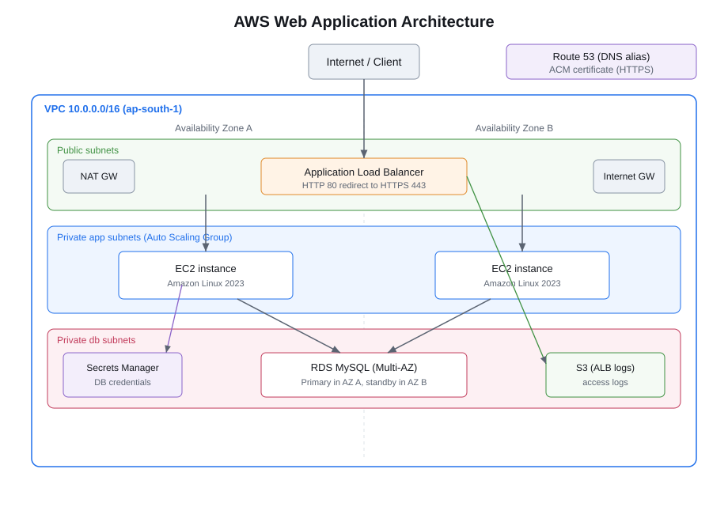

# Architecture

## Network

The VPC spans two Availability Zones and uses three subnet tiers:

- **Public** - holds the Application Load Balancer and the NAT Gateway. Routes to the Internet Gateway.
- **Private app** - holds the EC2 instances. Outbound traffic goes through the NAT Gateway; there is no inbound route from the internet.
- **Private db** - holds RDS. No route to the internet in either direction.

## Request path

1. A client resolves `app.<domain>` to the ALB through a Route 53 alias record.
2. The ALB serves HTTPS using an ACM certificate. HTTP on port 80 is redirected to 443.
3. The ALB forwards to the target group on the application port, spread across the instances in the Auto Scaling Group.
4. Each instance reads the database credentials from Secrets Manager at startup and connects to RDS over the private network.
5. ALB access logs are written to a dedicated S3 bucket.

## High availability

- The ALB and the Auto Scaling Group operate across both Availability Zones.
- RDS runs Multi-AZ with a standby in the second zone.
- The Auto Scaling Group uses ELB health checks and a CPU target-tracking policy.

## Security

- Database and application instances sit in private subnets.
- Security groups allow only the required paths: internet to ALB, ALB to app, app to database.
- Database credentials are generated by Terraform and stored in Secrets Manager; instances read them through an IAM role, so no secret is baked into the AMI or the code.
- RDS storage is encrypted; S3 buckets block all public access and are encrypted.
- Instances enforce IMDSv2.
